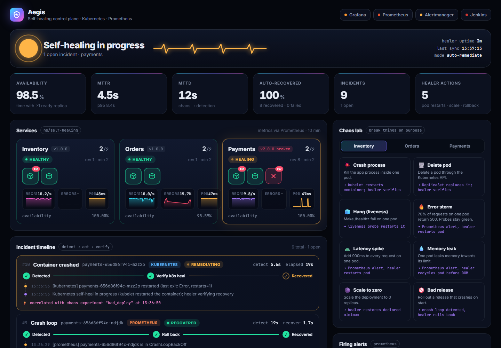
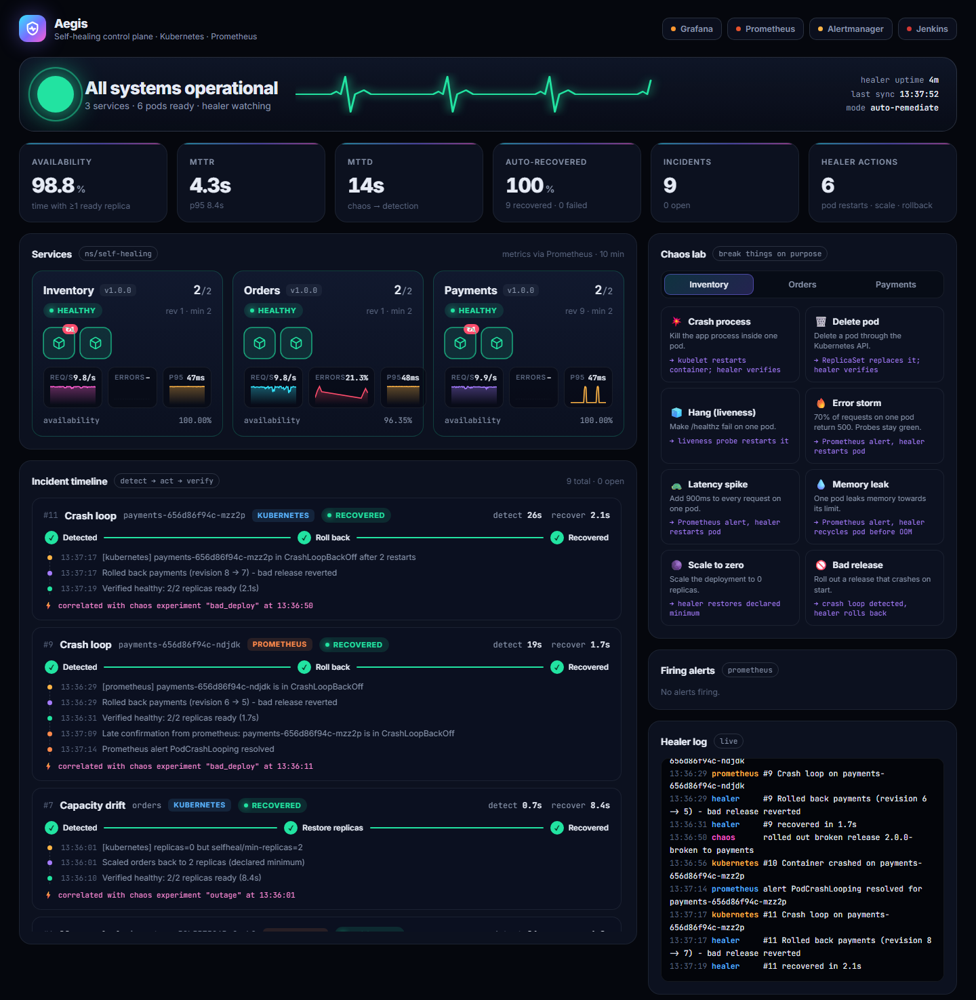
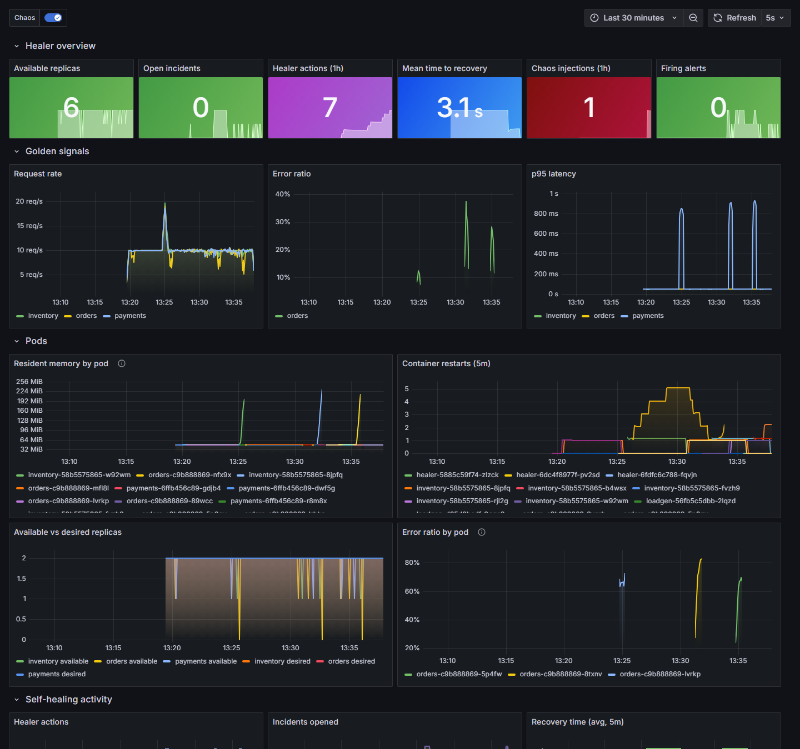
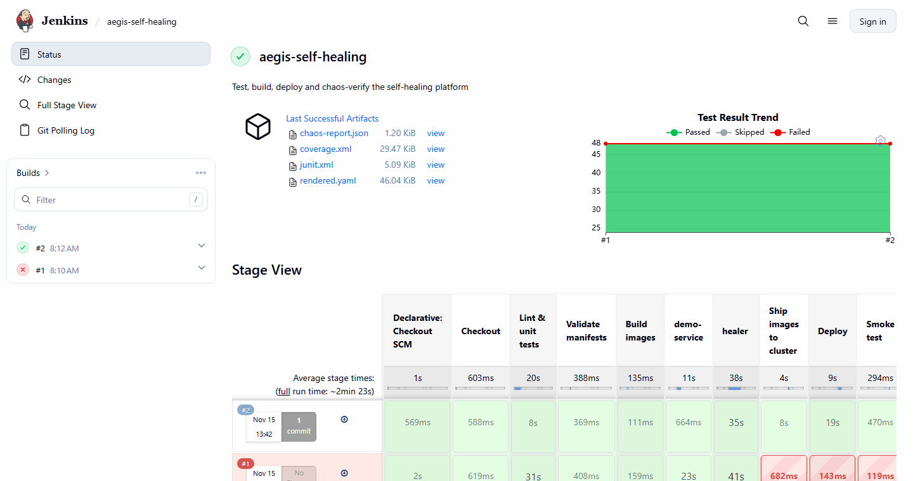
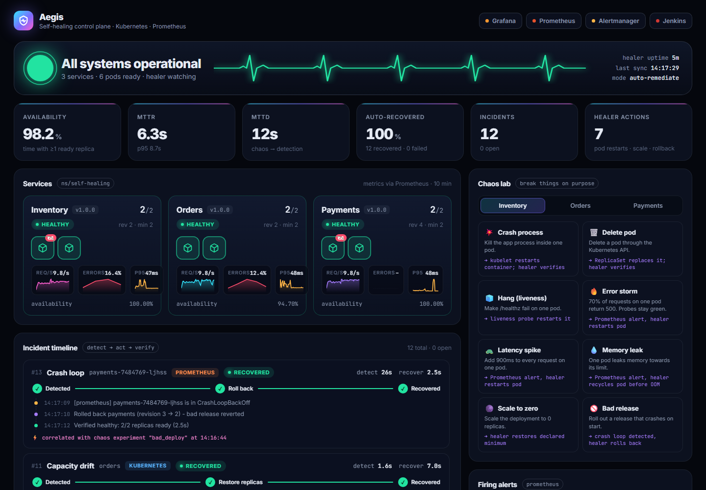

# Aegis: Self-Healing Infrastructure

Aegis detects application failures on Kubernetes and recovers them automatically, then
**verifies** that the recovery actually worked. You can break the system on purpose from the
dashboard and watch it heal itself.



| Layer | What it does |
|---|---|
| **Kubernetes (k3s)** | Runs three microservices (`orders`, `payments`, `inventory`) with probes, rolling updates and a load generator |
| **Prometheus + Alertmanager** | Scrapes every pod and fires alerts for failures that Kubernetes probes cannot see (error spikes, latency, memory leaks) |
| **Grafana** | Pre-provisioned dashboard showing golden signals, pod health and every healing action |
| **Python healer** | A controller that watches the cluster *and* receives Alertmanager webhooks, runs remediation playbooks, and measures time to recovery |
| **Jenkins** | Lint → test → build → deploy → smoke test → **chaos gate** (each build breaks the system and fails unless it heals) |
| **AWS EC2 (Terraform)** | One `terraform apply` provisions an instance that bootstraps the whole platform, Jenkins included |

---

## How it heals

```
                 ┌──────────────── detection ────────────────┐
  chaos / bug ─▶ │ Kubernetes watch (every 2s)               │
                 │   crash loops, restarts, lost pods,       │──┐
                 │   replicas below declared minimum         │  │
                 │ Prometheus ─▶ Alertmanager ─▶ webhook     │  │   ┌──────────────┐    ┌──────────────┐
                 │   5xx ratio, p95 latency, memory          │  ├──▶│ playbook +   │──▶ │ verify on    │──▶ recovered / failed
                 └───────────────────────────────────────────┘  │   │ guard rails  │    │ live cluster │      (MTTR recorded)
                                                                │   └──────────────┘    └──────────────┘
                     same failure from both sources = one incident (deduplicated)
```

| Failure | Who notices | Healer action |
|---|---|---|
| Process crash | kubelet restarts it | Verifies the container comes back Ready |
| Pod deleted | ReplicaSet replaces it | Verifies capacity is restored |
| Liveness hang | liveness probe | Verifies the restart |
| **Error storm** (probes still green) | Prometheus `HighErrorRate` | Deletes the bad pod, verifies its replacement |
| **Latency spike** | Prometheus `HighLatency` | Recycles the slow pod |
| **Memory leak** | Prometheus `HighMemoryUsage` | Recycles the pod *before* the OOM killer fires |
| **Scaled to zero** | watch + `ServiceDown` | Restores the `selfheal/min-replicas` declared on the Deployment |
| **Bad release** (crash on start) | watch + `PodCrashLooping` | **Rolls back** to the previous revision (zero downtime: `maxUnavailable: 0` keeps the old pods serving) |

**Guard rails.** Automated remediation that misbehaves is worse than none, so the healer has:
- **Cooldown**: never acts on the same target twice within 30s.
- **Circuit breaker**: at most 6 actions per deployment per 10 minutes. After that it *escalates*
  (notifies a human) instead of looping.
- **Rollback only when it is clearly a bad release**: the revision is fresh *and* none of its pods
  ever became Ready. One flaky pod on a healthy release is recycled, not rolled back.
- **Verification, not fire-and-forget**: an incident is `recovered` only when the replacement pods
  are Ready. Otherwise it is marked `failed` after a timeout.
- **Least privilege**: a namespaced Role. The healer can delete pods and patch Deployments in
  `self-healing` and nothing else.
- **Dry-run mode** (`HEALER_DRY_RUN=true`): logs what it would have done.

## Measured results

From `scripts/chaos_test.py` against the local k3s cluster. Each scenario injects a fault, then waits
until the healer reports a correlated incident as recovered *and* the service is fully healthy.
**8/8 scenarios healed automatically**, with no human involved:

| Scenario | Detected by | Action | Time to detect | Time to recover |
|---|---|---|---|---|
| Delete pod | Kubernetes watch | verify replacement | 1.8s | 4.1s |
| Process crash | Kubernetes watch | verify restart | 2.0s | 2.1s |
| Liveness hang | Kubernetes watch | verify restart | 8.4s | 2.1s |
| Error storm (70% 5xx) | Prometheus | restart pod | 25.6s | 5.7s |
| Latency spike (+900ms) | Prometheus | restart pod | 18.4s | 5.4s |
| Memory leak | Prometheus | restart pod | 24.1s | 6.9s |
| Scale to zero | Kubernetes watch | restore replicas | 0.7s | 8.4s |
| Bad release | Prometheus | **roll back** | 18.5s | 1.7s |

Metric-driven detection is slower by design: an alert needs a 30s rate window plus a `for:` hold to
avoid acting on a single noisy scrape. The bad-release rollback recovers quickly because
`maxUnavailable: 0` keeps the previous pods serving the whole time, so users never see the outage.

### Bugs the live chaos runs caught

Unit tests against a fake cluster passed. These two only showed up once real chaos ran against a
real cluster:

1. **Keep-alive pinning.** After a pod was replaced, the new pod received *zero* traffic. A
   Kubernetes Service balances per TCP *connection*, and the load generator's pooled keep-alive
   connections stayed on the surviving pod. An error injected into the new pod produced no 5xx and
   therefore no alert. The fix disables keep-alive in the load generator. Real clients hit the same
   problem, which is why L7 load balancing or a service mesh exists.
2. **Crash-loop escalation.** Prometheus flagged `CrashLoopBackOff` before the pod reached the
   healer's local restart threshold, so the healer recycled the pod instead of rolling back. The
   replacement crash-looped too, and that signal was only recorded as a confirmation. Now a firing
   crash-loop alert counts as meeting the threshold. If a remediation doesn't work (a replacement
   pod shows the same failure), the healer acts again within the same incident. Regression tests
   cover both.

---

## Quick start (local, only needs Docker)

```bash
make up          # k3s-in-Docker cluster + build images + deploy everything (~3 min)
```

| | URL |
|---|---|
| Aegis control plane | http://localhost:30080 |
| Grafana (anonymous view) | http://localhost:30030 |
| Prometheus | http://localhost:30090 |
| Alertmanager | http://localhost:30093 |

Open the control plane, pick a service in **Chaos lab**, click an experiment, and watch the incident
timeline go *Detected → Action → Recovered*.



Grafana (provisioned automatically; chaos experiments show up as spikes that return to baseline):



You can also run all scenarios automatically:

```bash
make chaos       # injects each fault, requires verified recovery, prints MTTD / MTTR
```

### Jenkins

```bash
make jenkins     # http://localhost:8080 (user admin, password generated into jenkins/.env)
```

The `aegis-self-healing` pipeline is created through Jenkins Configuration-as-Code and Job DSL.
It checks out this repository, runs ruff and pytest, builds both images, loads them into the cluster,
deploys, smoke-tests, and runs the chaos gate. A full run takes about 2.5 minutes:



### AWS EC2

```bash
cd infra/terraform
cp terraform.tfvars.example terraform.tfvars   # set allowed_cidr to your IP
terraform init && terraform apply
terraform output urls
```

The instance installs Docker and k3s (with Docker as its runtime), clones the repository, builds,
deploys, and starts Jenkins, all from `user_data`. No SSH is needed. Run `terraform destroy` when
you are done.

**Verified on AWS** (t3.large, Ubuntu 24.04, us-east-1):
- The control plane was serving traffic 2 minutes after `terraform apply`.
- While the instance was still bootstrapping, a CPU-starved node made containers fail their liveness
  probes. The healer recovered all 11 of the resulting incidents by itself. That led to adding a
  `startupProbe`.
- Jenkins on the instance picked up that commit from GitHub and ran the full pipeline, including the
  chaos gate (4/4 healed).
- The full 8-scenario chaos suite run against the instance passed 8/8.



---

## Repository layout

```
services/demo-service/   FastAPI microservice with Prometheus metrics + chaos endpoints (also the load generator)
healer/healer/           the self-healing controller
  engine.py              detection, remediation, recovery verification
  policy.py              pure decision logic: playbooks, cooldown, circuit breaker, rollback rule
  kube.py                Kubernetes API gateway (the only module that talks to the cluster)
  incidents.py           incident lifecycle, MTTR / MTTD stats
  chaos.py               fault injection
  main.py                FastAPI: Alertmanager webhook, control-plane API, UI
  static/index.html      the control-plane dashboard (single file, no build step)
k8s/                     kustomize: workloads, healer RBAC, Prometheus, Alertmanager, kube-state-metrics, Grafana
Jenkinsfile, jenkins/    pipeline + Jenkins image with JCasC
infra/terraform/         EC2 + security group + bootstrap
scripts/                 cluster-up, load-images, deploy, chaos_test
tests/                   unit + API tests (fake cluster, no Kubernetes needed)
```

## Development

```bash
python -m venv .venv && . .venv/bin/activate      # Windows: .venv\Scripts\activate
pip install -r requirements-dev.txt
make test lint
```

Tests run against an in-memory fake cluster, so the engine's behaviour is checked without a real
cluster: pod loss, error alerts, deduplication across sources, scale-to-zero, bad-release rollback,
circuit breaker, cooldown, failed actions, recovery timeouts, dry-run, chaos correlation, and
notifier failures.

## Configuration

All healer settings come from environment variables (`k8s/healer/healer.env`):

| Variable | Default | Meaning |
|---|---|---|
| `HEALER_RECONCILE_INTERVAL` | `2` | Seconds between cluster scans |
| `HEALER_COOLDOWN_SECONDS` | `30` | Quiet period per target after an action |
| `HEALER_BUDGET_MAX_ACTIONS` / `_WINDOW_SECONDS` | `6` / `600` | Circuit-breaker limit |
| `HEALER_CRASHLOOP_RESTARTS` | `2` | Restarts before crash-loop remediation |
| `HEALER_RECOVERY_TIMEOUT_SECONDS` | `180` | How long to wait for verified recovery |
| `HEALER_DRY_RUN` | `false` | Observe and log only |
| `CHAOS_ENABLED` / `CHAOS_TOKEN` | `true` / empty | Gate the chaos API (set a token, or disable it outside demos) |
| `NOTIFY_WEBHOOK_URL` | empty | Slack or Discord incoming webhook for incident notifications |
